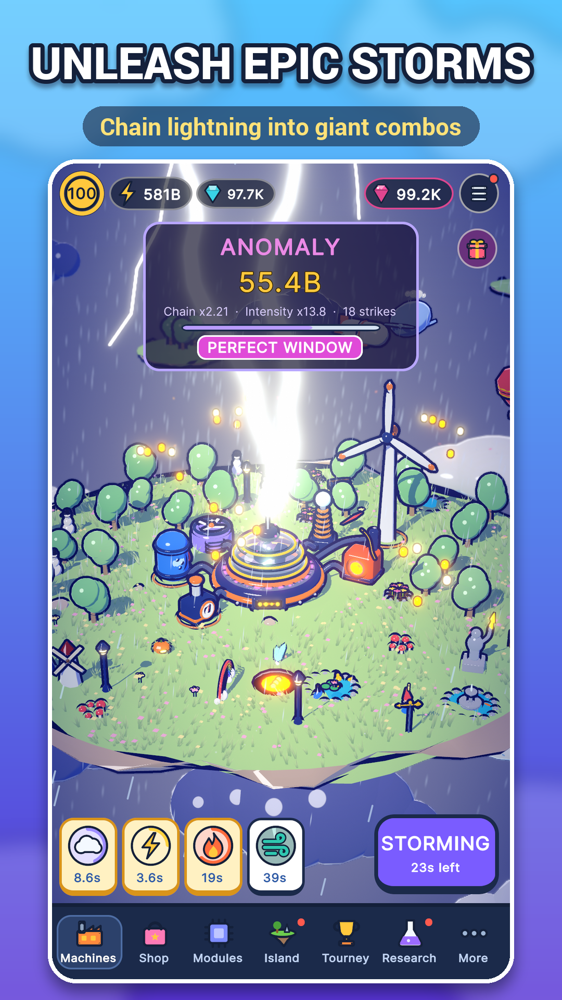

# Storm Engine

**Build. Optimize. Create the biggest storms.** A cartoon idle/optimization game for mobile and PC.

## About

You run a ridiculous machine that manufactures storms on a floating island. Every system multiplies the others, so the strategy is in balancing your build.

- Upgrade machines (pumps, condensers, Tesla coils, turbines) to raise Storm Power
- Discover weather phenomena such as Thunderstorm, Monsoon and Supercell by hitting thresholds
- Time boosts during a storm to land a Perfect Window
- Prestige ("Reset the Atmosphere") for permanent research upgrades
- Weekly server-verified tournament with leaderboards
- Localized into 12 languages

## Built with

Unity 6.3 · C# · Unity Gaming Services (Cloud Code, Leaderboards) · AdMob · Android

The code is split into modules: Core, Runtime, Online, Store, Ads and Notify. Edit-mode tests cover the core logic, and a separate C# balance simulator lives in `Tools/balance-sim`.

## Run it

1. Open the folder in Unity Hub (Unity 6.3).
2. Follow [STORM_ENGINE_SETUP.md](STORM_ENGINE_SETUP.md) for the scene and online services.
3. Press **Play**.

Full game design notes: [DESIGN.md](DESIGN.md)

## My role

Built with AI-assisted development. I designed the game and directed, tested and balanced it.
